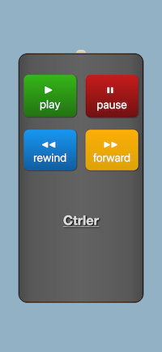

# Ctrler
*Use your phone as a remote controller for videos playing full-screen in your browser.*

## Introduction
`ctrler` allows you to control videos playing full-screen in your browser via your 
phone. It is most useful when your laptop is connected to a screen (e.g., a TV screen) 
and the keyboard/mouse is out of reach. It uses `pyautogui` to simulate keyboard and mouse 
actions, `FastAPI` for the API, and generates a QR code using `qrcode` for your phone to connect. 
Scan the QR code generated by the service and **use your phone to play, pause, rewind, or fast-forward.** 

> ⚠️ **Warning:** Use this tool at your own risk. It controls your system via simulated 
mouse and keyboard actions and is intended for trusted, properly secured, non-shared 
networks, such as your home network only. See the [security considerations](#security-considerations) 
for more information. The author is not responsible for any potential problems/damage 
resulting from using the tool. 

## Installation

Clone the repository and from the root of the project execute:

```bash
pip install .
```

## Usage

### Starting the service

To start the service, run:

```bash
ctrler --host <your-local-ip>
```
For known limitations of the tool, check [known limitations](#known-limitations). 

- The app runs on your local IP (default port 8000) and displays a QR code in the terminal.
- Scan the QR code with your phone to access the remote controller UI.
- Your phone must be connected to the same network as the machine running the service.
- For the purpose of this tool, it is recommended binding to a specific local ip, 
not 0.0.0.0. When binding to 0.0.0.0 a warning is shown, and explicit confirmation is 
needed.

Below is a screenshot of the remote controller UI.



### Supported actions

Currently, four simple actions are supported:

1. Play
2. Pause
3. Rewind
4. Fast-forward

Rewind and fast-forward behavior (number of seconds skipped) depends on the video 
player in use.

### Known limitations

#### Tested on macOS
This tool was primarily tested on macOS. It may work on other systems, but they have not 
been tested explicitly.

#### Video window focus and system sleep

For the actions to work reliably:

- The video window must be in focus.
- Video must be in full-screen mode (see below).

The machine must also be awake. When a computer goes to sleep or standby (e.g.,
when pausing a video for a while), 
the remote cannot wake it up, and simulated actions will not work.

On macOS, you can prevent sleep (for the time the service is running) by starting the service with:

```bash
caffeinate ctrler --host <your-local-ip>
```

On other systems, similar methods can be used.

Even with these precautions, actions may very occasionally fail to focus the video 
window, especially for rewind or fast-forward. If this happens, pressing play or 
pause first usually restores correct behavior.

#### Full-screen mode 
Videos must remain in full-screen for the tool to work reliably. 
Otherwise, actions may click unintended elements on screen.

### Security considerations

**Using this tool is at your own risk.**

Run this tool only on trusted, properly secured, non-shared networks, 
such as your home network. Running it on public or unsecured networks is not recommended.

#### Session token and HTTPS
To provide a basic level of security, a session token is generated when the service starts. 
Only API requests that include the correct token in the Authorization header are executed. 
Requests without the correct token return an HTTP 401 Unauthorized error. 

The session token is embedded in the URL fragment (after #) and the URL is embedded in 
the QR code so your phone can access the API. Do not share the token, the URL or the 
QR code with anyone. Anyone with access to your local network and the session token 
can control video playback while the app is running. 

Restarting the service will generate a new session token if needed. Note that 
the app does not use HTTPS, as it is designed for use only on trusted, 
properly secured, non-shared networks, such as your home network.

#### Controls performed and permissions
The actions that can be performed are explicitly defined and limited.
Specifically, the remote can only:

- Press play/pause (via a single fixed-position click)
- Press the left and right arrow keys for rewind/fast-forward

Before each action is executed, the app performs a tiny mouse movement to try to 
focus the video window. The cursor is immediately restored to its original position, 
so it does not move all over the screen.

This project uses `pyautogui` to perform these actions. Depending on your OS, you might 
need to either run as admin, or set extra accessibility permissions (macOS). 
Doing this is at your own risk.